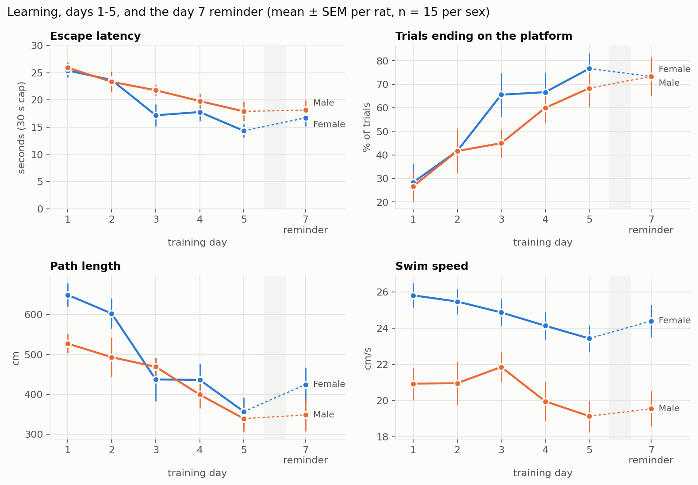
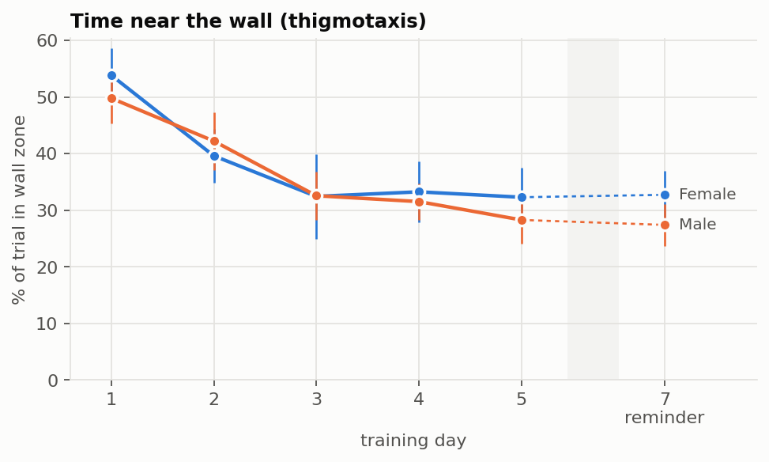
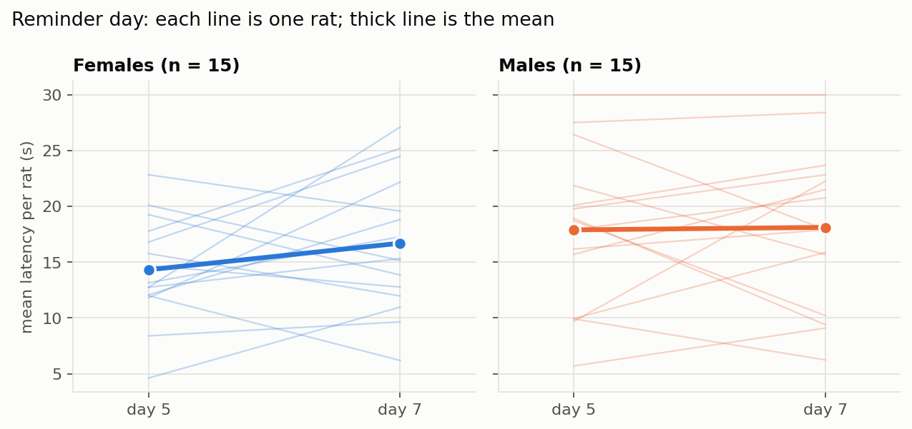
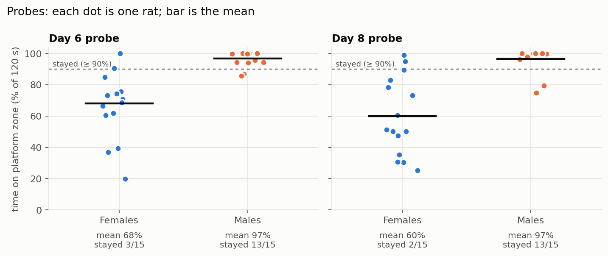
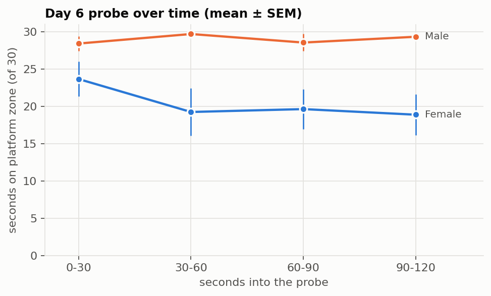
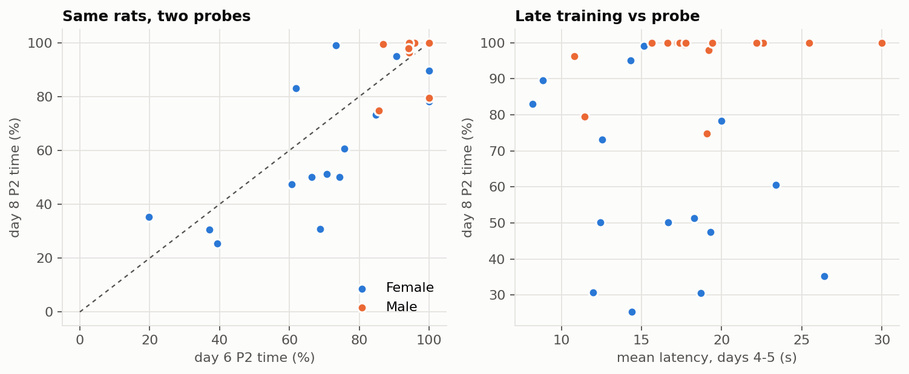
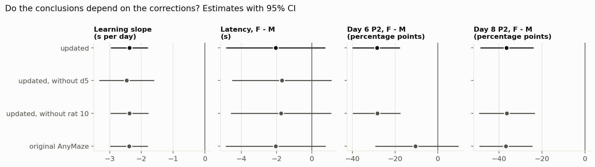

# Water maze analysis report

Generated by `analysis.py` from the corrected AnyMaze files in `..`. Rerun the script after any data change: every number, table and figure below is rebuilt from the data.

## Data

- 30 rats (rats 1-32 except 11 and 19, who died and are not in the data). 15 males (rats 1-16), 15 females (rats 17-32).
- Rats were tested in two batches of 15 (batch 2 = rats 9-16 and 25-32). Batch is a nuisance factor, used only as a control.
- Days 1-5: 4 trials a day, 30 s cap. Days 6 and 8: 120 s probes that start with the rat placed on the platform (recordings labelled 1.5 cm and 3 cm). Day 7: reminder, 4 trials.
- The corrected files change 40 trials' values (plus d5 t53 blanked and d4 tests 73-88 relabeled). See `../README.md` and `../changes.csv`.
- Unit of analysis is the rat: trials are averaged per rat per day before modelling, except the trial-level GEE.

## Methods

- **Learning (days 1-5):** linear mixed model per outcome, `outcome ~ day x sex + batch`, random intercept and day slope per rat (REML). Day is centred; sex and batch are coded -0.5/+0.5, so main effects are averages across the other factor.
- **Finding the platform:** binomial GEE on trials (`found = duration < 29.5 s`), same terms, exchangeable correlation within rat. Reported as odds ratios.
- **Reminder (day 5 to day 7):** paired t test and Wilcoxon on each rat's mean latency; sex difference in the change by Mann-Whitney.
- **Probes (days 6, 8):** time in the platform zone (P2) as % of the probe. Sex compared by Mann-Whitney (rank-biserial effect size) and bootstrap 95% CI of the mean difference; "stayed" means at least 90% of the probe on P2, compared by Fisher exact test. Day 6 time course: mixed model on P2 seconds per 30 s segment.
- **Multiple testing:** five primary sex comparisons (latency sex effect, day x sex, reminder change by sex, day 6 and day 8 P2 by sex) are Holm-corrected in `results/statistics.csv` (`p_holm_primary`). Everything else is exploratory and uncorrected.
- **Sensitivity:** key models are rerun without day 5 (the only day without a start-time check), without rat 10 (nose bleed on day 4), and on the original AnyMaze values.

## Results

### 1. Rats learned the task (Figure 1)

Mean latency fell from 25.7 s on day 1 to 16.1 s on day 5, and the share of trials ending on the platform rose from 28% to 72%.

| Term (latency model) | Estimate [95% CI] | p |
|---|---|---|
| Day (s per day) | -2.38 [-2.96, -1.80] | p < 0.001 |
| Sex (F - M, s) | -2.05 [-4.87, 0.77] | p = 0.154 |
| Day x Sex | -0.85 [-2.01, 0.32] | p = 0.154 |
| Batch (2 - 1, s) | -0.34 [-3.25, 2.58] | p = 0.821 |

- Path length fell by 61 cm per day (p < 0.001), with no sex difference (p = 0.157).
- The odds of finding the platform rose 1.61-fold per day (p < 0.001); sex odds ratio 1.41 (p = 0.245).
- **Females swam faster:** +4.0 cm/s [2.3, 5.8], p < 0.001. Batch 2 swam +1.9 cm/s (p = 0.032). Speed fell 0.53 cm/s per day.
- **Wall-hugging (Figure 2)** fell 5.2 percentage points per day (p < 0.001); sex difference +1.0 points (p = 0.849). Thigmotaxis is blank on corrected trials, so those trials drop out of this outcome.

### 2. No loss on the reminder day (Figure 3)

Latency changed +1.3 s from day 5 to day 7 (95% CI -1.1 to 3.7; p = 0.269; Wilcoxon p=0.358, dz=0.21, n=30). Females minus males in that change: +2.2 s (p = 0.300). The CI is the honest summary: a loss of a few seconds cannot be ruled out.

### 3. On the probes, males stayed and females left (Figures 4-5)

| | Females, P2 % | Males, P2 % | F - M [95% CI] | p | Stayed, F / M | Fisher p |
|---|---|---|---|---|---|---|
| Day 6 | 68.2 | 96.7 | -28.5 [-40.0, -17.7] | p < 0.001 | 3/15 vs 13/15 | p < 0.001 |
| Day 8 | 60.0 | 96.5 | -36.5 [-48.7, -23.9] | p < 0.001 | 2/15 vs 13/15 | p < 0.001 |

- Both survive Holm correction (day 6 p_holm = 0.0010, day 8 p_holm = 0.0001).
- Batch made no difference on either probe (day 6 p = 0.933, day 8 p = 0.916).
- Rats behaved consistently across the two probes (Figure 6): Spearman rho d6 vs d8 = 0.78; mean change d8 - d6 -4.2 points (p = 0.158).
- Late-training latency does not predict probe behaviour (day 6 +0.09, p = 0.630; day 8 +0.19, p = 0.307).
- Day 6 time course (Figure 5): females averaged -8.7 s per 30 s segment against males (p < 0.001); segment x sex p = 0.175. Female means by segment: 23.7, 19.2, 19.6, 18.9 s; male: 28.4, 29.7, 28.6, 29.3 s.

### 4. Sensitivity (Figure 7)

- The learning slope and the day 8 sex difference hold in every version of the data.
- **The day 6 sex difference depends on the corrections:** on the original AnyMaze values it is -10.5 [-29.3, 9.6] points (p = 0.096), against -28.5 [-40.0, -17.7] (p < 0.001) corrected. AnyMaze lost track of several males sitting on the platform (low tracking) and ended rat 4's probe at 4.6 s.
- Removing day 5 or rat 10 changes nothing that matters.

## Interpretation, with limits

- Males and females learned at a similar rate. Females swam faster, so equal latencies came from different swimming.
- The probe difference is large and consistent, but these data cannot say whether leaving reflects memory, motivation to escape, body size or activity. The lab notes record leaping for the ledge and repeated departures. Late-training performance does not predict it.
- ANY-maze stopped trials on the first platform zone entry. Unfilmed trials keep that rule, while corrected trials use touch and stay.
- Latency is capped at 30 s, which compresses differences on early days. The GEE on found / not found is the check on that.
- Day 5 has no start-time check. Absolute distances may read about 5% low. Small samples (15 per sex): the CIs, not the p values, show what the data can support.

## Files

- `results/statistics.csv`: every estimate, CI and p value, by analysis, dataset, outcome and term.
- `results/rat_day_means.csv`, `results/probe_by_rat.csv`: the per-rat data behind the figures.
- `figures/`: fig1 learning, fig2 thigmotaxis, fig3 reminder, fig4 probes, fig5 day 6 time course, fig6 probe relations, fig7 sensitivity.

